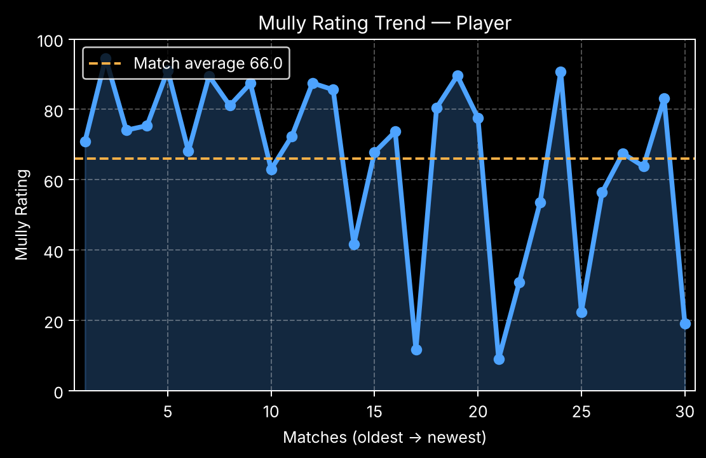

<p align="center">
  
</p>

<h1 align="center">FACEIT Mully Rating Bot</h1>

<p align="center">
  A Telegram bot that rates FACEIT CS2 players from 0 to 100,
  using more than K/D and ADR.
</p>

<p align="center">
  <a href="https://github.com/KeonMei/Mully-Rating-Faceit/actions/workflows/tests.yml"></a>
  
  
</p>

---

Send the bot a FACEIT nickname and it analyses the player's last
10–100 CS2 matches. It combines **combat** (ADR, K/D, K/R, MVPs),
**multikills**, **opening duels** and **clutches** into one
**Mully Rating**, where **50 is an average FACEIT player**.

## Contents

- [What the bot shows](#-what-the-bot-shows)
- [How the Mully Rating works](#-how-the-mully-rating-works)
- [Quick start](#️-quick-start)
- [Tests](#-tests)
- [Tuning the rating](#-tuning-the-rating)
- [Project structure](#-project-structure)
- [Under the hood](#️-under-the-hood)
- [Roadmap](#-roadmap)

---

## 📊 What the bot shows

**1. Send a nickname or a profile link**, then pick how many matches to
analyse: 10, 30, 50 or 100.

```text
https://www.faceit.com/en/players/your_nickname
```

**2. Player card**: the rating, tier and where the score comes from.

```text
👤 Player
🇰🇿 | Level 10 | 2310 ELO

Matches analyzed: 30

Mully Rating: 73.9
▰▰▰▰▰▰▰▰▰▰▰▰▰▰▱▱▱▱▱▱

Rank: 🟢 B (Good)

Breakdown (50 = average player):
Combat 76 · Multikills 77
Entry 41 · Clutch 66

ADR 91.4 · K/D 1.31 · K/R 0.95
```

**3. Trend 📈**: the rating of every match, oldest to newest.

<p align="center">
  
</p>

**4. Maps 🗺**: the rating on each map and how many games it is based on.

```text
🗺 Map Mully Rating — Player
Last 30 matches

🔵 Inferno  83.9 ████████░░ 3
🔵 Mirage   80.5 ████████░░ 6
🟢 Nuke     73.2 ███████░░░ 4
🟢 Ancient  70.9 ███████░░░ 6
🟢 Anubis   67.2 ██████░░░░ 4
🟢 Dust2    66.8 ██████░░░░ 7
```

*The examples above are generated from sample data.*

---

## 🧠 How the Mully Rating works

```text
combat = 45% ADR + 40% K/D + 12% K/R + 3% MVP

Mully Rating = 100 × (80% combat + 10% multikills + 5% entry + 5% clutch)
```

1. **Stats are added up over all matches**: K/D is total kills / total
   deaths, ADR and K/R are weighted by rounds, so one extreme game does
   not dominate.
2. **Each stat is scaled from 0 to 1** between three anchors: weak → 0,
   average FACEIT player → 0.5, elite → 1. For example ADR 55 / 80 / 110,
   K/D 0.60 / 1.00 / 1.60.
3. **Clutches are compared with an average player** (who wins about
   40% of 1v1 and 8% of 1v3), so a won 1v3 counts much more than a 1v1.
4. **Small samples are pulled towards average**, so one lucky clutch
   does not swing the rating.

| Tier | Score | |
| ---- | ----- | --- |
| 🟣 **S** | 90–100 | Strong: elite in almost everything |
| 🔵 **A** | 75–89 | Great: clearly carries games |
| 🟢 **B** | 60–74 | Good: above average |
| 🟡 **C** | 45–59 | Average FACEIT player |
| 🔴 **D** | 0–44 | Weak: below average |

📖 Full explanation, a worked example and what changed from the first
version of the formula: **[docs/rating.md](docs/rating.md)**.

---

## ⚙️ Quick start

You need **Python 3.11+**, a [FACEIT API key](https://developers.faceit.com)
(server-side key) and a Telegram bot token from
[@BotFather](https://t.me/BotFather).

```bash
# 1. Clone
git clone https://github.com/KeonMei/Mully-Rating-Faceit.git
cd Mully-Rating-Faceit

# 2. Install
python -m venv .venv
source .venv/bin/activate        # Windows: .venv\Scripts\activate
pip install -r requirements.txt

# 3. Configure
cp .env.example .env             # then put your keys into .env

# 4. Run
python bot.py
```

| Variable | Description |
| -------- | ----------- |
| `FACEIT_API_KEY` | FACEIT Data API key |
| `TG_BOT_TOKEN` | Telegram bot token |

If a variable is missing, the bot stops with a message saying which one.

---

## 🧪 Tests

```bash
pip install -r requirements-dev.txt
python -m pytest
```

The tests use a fake FACEIT API and a fake Telegram server, so they
need no keys and no internet. They also run on GitHub Actions for
every push (Python 3.11 and 3.14).

---

## 🎯 Tuning the rating

The anchors that define "weak", "average" and "elite" are constants in
[`mully_rating/rating/formula.py`](mully_rating/rating/formula.py). To
fit them to real players, list nicknames in a file (one per line, 50+
players is best) and run:

```bash
python scripts/calibrate.py --file players.txt --matches 50
```

The script prints every player's stats and a ready-to-paste `ANCHORS`
table built from the 10th percentile, median and 95th percentile.

---

## 📦 Project structure

```text
Mully-Rating-Faceit/
├── bot.py                    # entry point: python bot.py
├── mully_rating/
│   ├── config.py             # reads FACEIT_API_KEY / TG_BOT_TOKEN
│   ├── analyzer.py           # downloads matches → PlayerReport
│   ├── faceit/               # everything that talks to FACEIT
│   │   ├── client.py         #   HTTP session, timeouts, retries
│   │   ├── players.py        #   profile and match history
│   │   └── matches.py        #   match details + cache
│   ├── rating/               # the math, no network or Telegram
│   │   ├── formula.py        #   the Mully Rating formula
│   │   ├── tiers.py          #   S–D tiers, emoji, progress bar
│   │   └── maps.py           #   rating per map
│   └── bot/                  # the Telegram bot
│       ├── app.py            #   builds the bot, registers handlers
│       ├── handlers.py       #   messages and button taps
│       ├── keyboards.py      #   buttons and their data
│       ├── messages.py       #   texts the bot sends
│       ├── nickname.py       #   nickname / profile link parsing
│       ├── reports.py        #   recent analyses for Trend / Maps
│       └── charts.py         #   trend chart image
├── scripts/
│   └── calibrate.py          # suggests rating anchors from real players
├── tests/                    # same layout as mully_rating/
├── docs/
│   └── rating.md             # how the rating works
├── assets/                   # logo and README images
├── requirements.txt
├── requirements-dev.txt      # + pytest
├── pyproject.toml            # pytest settings
└── .env.example
```

---

## 🛠️ Under the hood

- **Several users at once.** FACEIT requests run in worker threads and
  Telegram updates are handled concurrently, so one long analysis does
  not freeze the bot.
- **Fast and polite to the API.** One keep-alive HTTP session, up to 10
  parallel requests, automatic retry with backoff on rate limits (429)
  and server errors, 10-second timeouts.
- **Caching.** Match details are cached in memory (up to 2000 matches,
  all 10 players each). The Trend and Maps buttons reuse the last
  analysis for 10 minutes instead of downloading it again.
- **Stateless buttons.** Every button carries the nickname and match
  count, so buttons keep working after a restart.
- **Clear errors.** Unknown player, no CS2 matches and FACEIT being down
  each get their own message.

Tech stack: Python, [python-telegram-bot](https://python-telegram-bot.org),
requests, matplotlib, pytest.

---

## 📈 Roadmap

- [ ] Player comparison (`/compare nick1 nick2`)
- [ ] Playstyle detection (entry fragger, clutcher, support…)
- [ ] Tips based on the weakest part of the breakdown
- [ ] Persistent cache (SQLite / Redis) that survives restarts
- [ ] Web interface

---

## ⚠️ Notes

- Do not commit your `.env` file (it is in `.gitignore`).
- The rating is an analytical tool, not an official FACEIT ranking.
- FACEIT matchmaking pairs players of similar ELO, so the rating shows
  how a player performs **against their own level**.

## 📄 License

MIT
